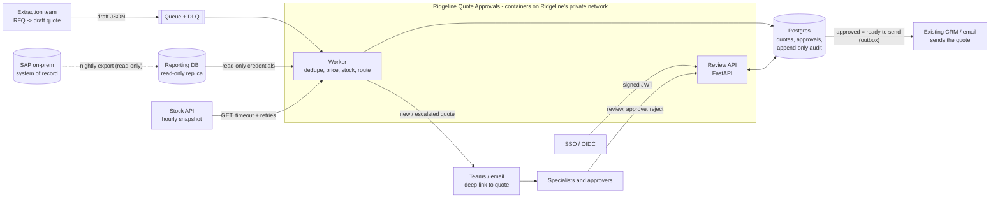

# Ridgeline Quote Approvals

Takes the extraction team's draft quotes, applies contract pricing and stock checks, and routes each
quote for approval under Ridgeline's policy, with a person approving every quote and a full audit trail.
It never writes to SAP and never sends quotes: "approved" means ready to send.

## Repository

TODO: public GitHub URL

## How to Run

Requires Python 3.11+. On Windows use `127.0.0.1`, not `localhost` (the mock binds IPv4 only, and
`localhost` costs ~2 s per request while Windows tries IPv6 first).

**1. Install.** PowerShell:

```powershell
python -m venv .venv
.venv\Scripts\Activate.ps1
pip install -r requirements.txt
```

bash (in Git Bash on Windows the activate script is `.venv/Scripts/activate`):

```bash
python -m venv .venv && source .venv/bin/activate
pip install -r requirements.txt
```

Settings come from environment variables or a local `.env` (never committed); names are in
`.env.example`. Defaults work for the sample run.

**2. Start the mock stock API** (own terminal; 10% of requests return 503 by default)

```powershell
python data/mock_stock_api.py                                # normal
$env:MOCK_FAILURE_RATE="1"; python data/mock_stock_api.py    # stock API "down"
```

```bash
python data/mock_stock_api.py
MOCK_FAILURE_RATE=1 python data/mock_stock_api.py
```

**3. Process the sample drafts** (writes `app.db` and `outputs/`)

```bash
python -m app.process data/draft_quotes.json --reset     # same command in PowerShell
```

Expected summary: `specialist_only 3`, `approver_required 6`, `duplicate 1`, audit chain OK.
`--as-of` sets the business clock for out-of-office and staleness (default `2026-10-12T09:30:00-05:00`,
as the policy specifies, so the output is the same whatever day it runs; `--as-of now` for real time).
`-v` logs every stock API attempt. Output: `outputs/routing_results.json` (validated against
`app/schemas/routing_results.schema.json` before it replaces the old file) and
`outputs/routing_explanations.json` (trace per quote).

**4. Start the review API** (own terminal)

```powershell
$env:CLOCK_OVERRIDE="2026-10-12T09:30:00-05:00"; uvicorn app.api:app --port 8000
```

```bash
CLOCK_OVERRIDE=2026-10-12T09:30:00-05:00 uvicorn app.api:app --port 8000
```

OpenAPI docs at http://127.0.0.1:8000/docs. Identity is the `X-User-Id` header (stub; see Approach).

**5. Run the API demo** (needs a fresh `app.db`: re-run step 3 with `--reset` and restart the API)

```bash
python scripts/demo.py
```

**6. Run the tests** (no network; the stock API is faked from `data/stock_fixture.json`)

```bash
pytest -q
```

## Approach

**Pipeline** (`app/pipeline.py`): duplicate check -> pricing -> one bulk stock lookup -> routing ->
store + audit. Pricing, stock flags, duplicate detection, routing and the review workflow are pure
functions; I/O lives in adapters (`reporting.py`, `drafts.py`, `stock_client.py`, `store.py`).
Money is `Decimal` end to end and rounded only at the output boundary.

**Pricing** (`app/pricing.py`, from the read-only reporting snapshot in `data/reporting_db/`):
- The contract price is used when one is valid today (Central date), otherwise the list price.
  An expired contract means list price plus a flag on the line. Discontinued parts are flagged and
  never substituted automatically.
- The proposed discount is applied on top of the line price. **Effective discount = 1 - net / list
  total**, so contract savings count: DQ-24103 proposes 22% but is 26.22% effective (VP), and DQ-24107
  proposes 12% but is 15.38% (regional manager).
- Unknown product or customer: price what we can and flag the rest. Export older than 36 h: quote flag.

**Stock** (`app/stock_client.py`, `app/stock_flags.py`): bulk `GET /v1/stock` in chunks of 50.
Flags: not found, out of stock in all warehouses, partial stock, reading older than 24 h, and
"stock unavailable after N attempts". The quote is always routed; it is never blocked and stock is never guessed.

**Routing** (`app/router.py`): first matching tier wins, comparing the unrounded effective discount
and the net total: VP if > 25%; regional manager for the customer's region if > 15% or net >= $25,000;
otherwise specialist only. Out-of-office approvers go to `backup_approver_id`, following the chain
with cycle detection. If nobody is available, the quote stays with the last approver and is flagged.
Lines with extraction confidence < 0.85 always go to the specialist first. Every quote gets specialist
sign-off (`prepared_by`, or their backup). Each decision records a human-readable `trace` plus
`rules_version` and `rules_hash`.

**Review workflow** (`app/workflow.py`, `app/api.py`):
`pending_specialist_review -> [pending_approver ->] pending_final_signoff -> approved`, and any pending
state can go to `rejected` (with a reason). Only a human can move a quote to `approved`, through final sign-off.

**Where the rules live:** `rules/approval_rules.yaml` holds the policy only: thresholds, tiers,
confidence and staleness limits, the duplicate window, and the escalation SLA (a proposal, off by
default). Each value cites its rule number in `data/approval_rules.md`. People (approvers, regions,
backups, out-of-office) come only from `approvers.csv`. On start the YAML is validated: strict schema,
catch-all last tier, every needed role exists (one regional manager per customer region), backups exist,
no approver backup cycles. If it is invalid, the service refuses to start. Every change gets a new
`version` and content hash. `POST /rules/simulate` shows the impact on open quotes; `POST /rules/reload`
activates the rules without a code release. Ambiguities and the rulings on them are in `DECISIONS.md`.

**Stubs**

| Stubbed | Why | Production version |
|---|---|---|
| Quote editing (`PATCH` -> 501) | Brief allows it; time | Edit creates new quote_version, reprices via `price_quote`, re-runs stock + router, resets approvals that no longer apply, audits field-level before/after |
| Sending quotes | Out of scope; "approved" = ready to send | Outbox table -> CRM/email integration, idempotent send, still no SAP write |
| Auth (X-User-Id header) | Brief allows simple check | SSO/OIDC (Entra ID), JWT roles from IdP groups, approvers.csv reconciled from HR/SAP |
| Stock API (local mock) | Real API owned by Ridgeline IT | Real hourly API via private network, circuit breaker, cached last reading with as_of |
| Reporting DB (CSV files) | Data pack format | Read-only replica / warehouse connection with read-only credentials; freshness from export metadata |
| Escalation (computed + audited, no notification) | SLA not in policy (proposal) | Scheduler + Teams/email notifications, escalation to backup |
| Double-approval / lost-quote prevention | Brief allows explanation | Optimistic version check (built) + DB unique constraints, transactional outbox, queue with DLQ, reconciliation job |
| Rule changes | File edit + reload | Rules in DB/config service with admin UI, validation, four-eyes approval, versioned + audited, effective dates |
| SQLite app.db | Simple store allowed | Managed Postgres, backups, PITR |
| Audit hash chain in SQLite | Tamper-evidence demo | Append-only/WORM store (e.g. immutable object storage or ledger table), periodic anchoring |

In short:
- **Auth header -> SSO.** `X-User-Id` is looked up in `approvers.csv`; it is not authentication.
- **`PATCH` edit -> reprice + reroute + invalidate approvals.** Today it returns 501 with that flow.
- **`escalate_overdue()` -> scheduled worker.** It is a pure function that already computes the reassignments.
- **SQLite -> Postgres.**
- **Mock stock API -> Ridgeline's real API.**

The one decision that matters most: **The one decision that matters most:** an approval is bound to the exact version of the quote the approver saw. Every approval records the quote's version and content hash. If anything changes afterwards (an edit, a reprice, new stock data), the approval is cancelled and the quote is routed again. That is what makes it safe to speed approvals up: faster routing never means a quote goes out that nobody approved in its final form.

## Reliability

- **Retries, backoff, timeouts.** Each attempt has a 2 s timeout, with up to 4 attempts. Timeouts,
  connection errors and 5xx are retried; 4xx and invalid JSON are not. The delay is the 503 body's
  `retry_after_seconds` (capped at 5 s), otherwise full-jitter exponential backoff. Every attempt is
  logged as structured JSON. When retries run out the call never raises: each part in it is marked
  `unavailable`, and the quote gets "stock unavailable after 4 attempts" and is still routed.
- **Stale vs unavailable.** *Stale* means we have a reading but it is older than 24 h (stock) or the
  export is older than 36 h (pricing); the reading is used and flagged. *Unavailable* means we have no
  reading, and we never guess one. In the sample, RL107944 is 49.5 h old, so DQ-24104 and DQ-24109 are flagged.
- **Degraded data adds review, never removes it.** Missing, stale or unavailable data only adds
  `specialist_review_flags`; it cannot lower a tier or drop an approver (tested on all 10 drafts with a
  37 h-old export). Unknown discount routes to the VP; unknown region leaves the approver unassigned and flagged.
- **Duplicates** (rule 11). The fingerprint is a sha256 of `rfq_id` plus the sorted (part, quantity)
  pairs, so line order and case don't matter. A match against an original within 24 h, in the batch or
  in the store, gives `status: duplicate` and `duplicate_of`. It is not priced or routed and gets no
  approval request; it shows the original's totals (`DECISIONS.md` A4). DQ-24110 is a duplicate of DQ-24102.
  Re-running the pipeline is idempotent.
- **Optimistic concurrency.** Every state change sends the `version` the user saw; a mismatch is a 409.
  The update is `WHERE version = ? AND status = ?`, and approvals are `UNIQUE(quote, version, step)`,
  so the same step cannot be approved twice.
- **Roles and separation of duties.** Specialists see all quotes; approvers see quotes routed to them.
  Only the routed approver (after backup) can approve; the out-of-office original gets a 403 that names
  the backup. Specialists cannot do the approver step and approvers cannot do specialist steps.
  Missing or unknown user is a 401. Every denied attempt (401/403/404/409/422) is audited.
- **Tamper-evident audit.** `audit_log` is append-only (SQLite triggers reject UPDATE/DELETE), and each
  row's hash is `sha256(prev_hash + canonical row)`. `GET /audit/verify` re-walks the chain and names the
  first altered entry, even if the triggers were bypassed. Audit timestamps are real wall-clock time,
  not the `--as-of` business clock.

## Production



No arrow points into SAP: the service only reads the reporting replica (an SAP export) and the stock API.

**Deployment**
- One container image run as two processes: the API (behind Ridgeline's reverse proxy, SSO enforced) and
  the worker (consumes the drafts queue, runs the escalation scheduler). It runs on Ridgeline's private
  network, close to the on-prem replica.
- Managed Postgres with backups and point-in-time recovery. The audit table has insert-only grants and
  is exported to WORM storage.
- Secrets come from a vault or the platform secret store; no secrets in images or the repo. The CI
  pipeline runs the tests, validates the rules file, and deploys blue/green.

**Monitoring**
- p50/p90 draft -> approved time per tier and per approver (computed from audit timestamps). This is the
  headline metric against today's 4-6 h wait.
- Queue depth and age of the oldest pending quote per state; SLA breaches and escalations.
- Stock API error rate, retries per call, share of quotes flagged "unavailable"; circuit-breaker state.
- Data staleness: reporting export age (alert above 36 h) and stock `as_of` age.
- % specialist-only vs approver-required, flag rate per reason, rejection rate, audit-chain verify (nightly job).

**Changing approval rules without a release**
- Rules stored in the database with `effective_from` / `effective_to` dates and the same validation as
  today's YAML.
- An admin UI with maker-checker: one person proposes, a second approves, and both are audited.
- `/rules/simulate` runs a proposed change against open and recent quotes before activation.
- `rules_version` and `rules_hash` are stored on every routing decision, so any approval can be
  explained by the exact rules in force.

**With two more weeks**
- Build quote editing: new version, reprice, reroute, invalidate approvals, field-level audit.
- SSO/OIDC; approver availability fed from HR/calendar instead of a nightly CSV; Teams notifications and
  the escalation worker.
- Postgres plus a transactional outbox to the CRM; a reconciliation job for lost or stuck quotes.
- A minimal reviewer UI. Load test at 400 RFQs/week with headroom, plus property-based tests on the
  tier boundaries.
- Agree with Ridgeline on the open policy questions in `DECISIONS.md` (partial stock, escalation SLA,
  who owns rule changes).
